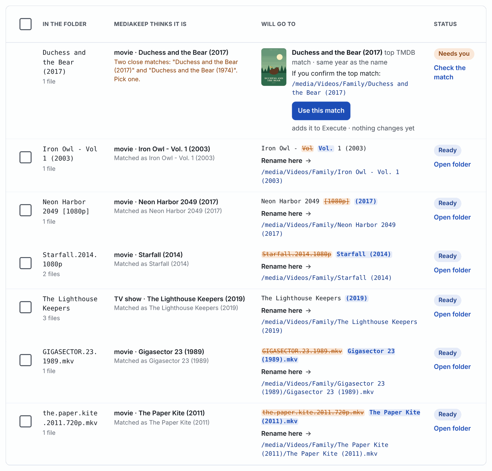
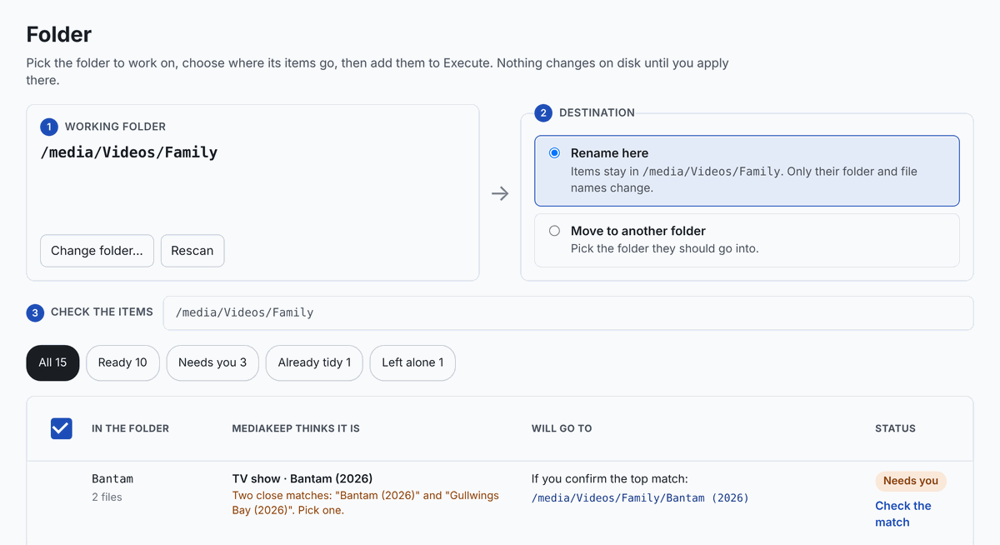
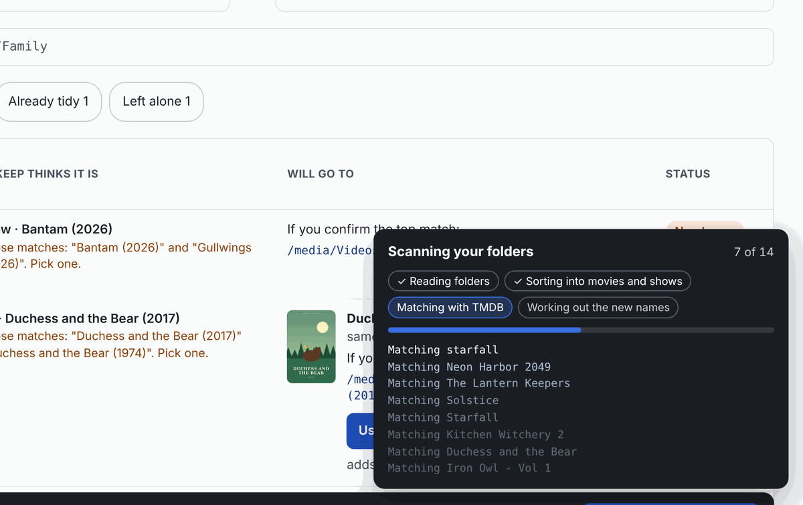
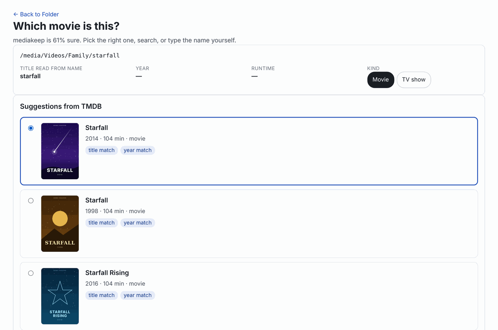
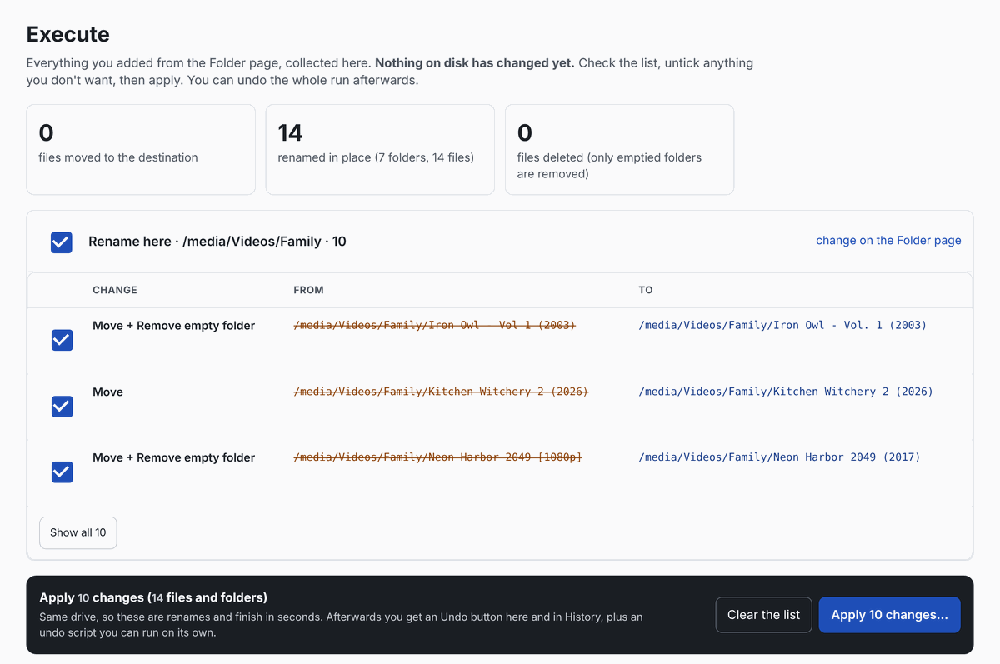
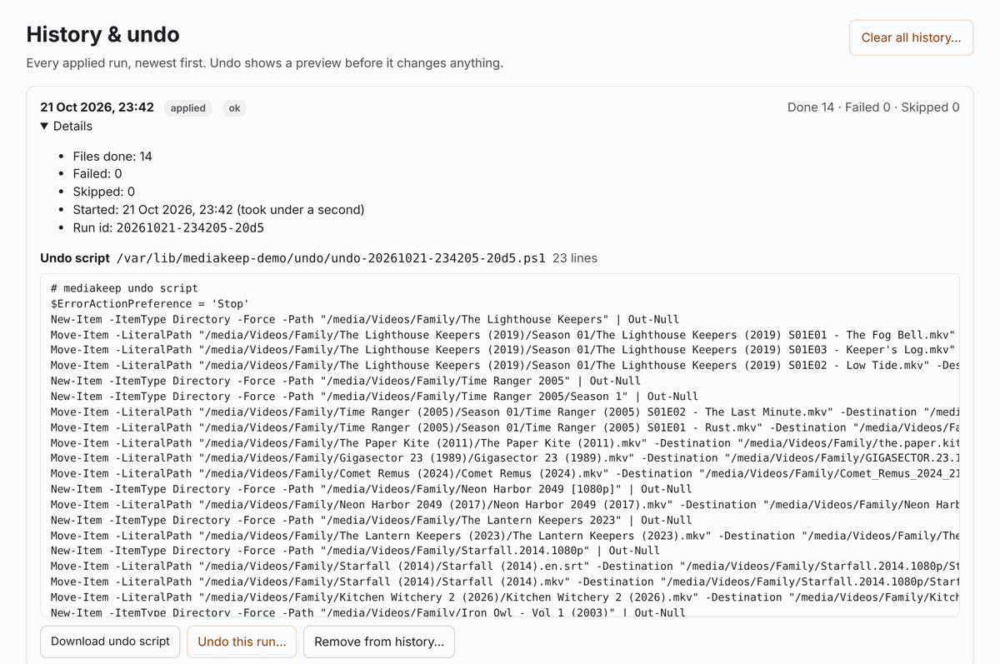
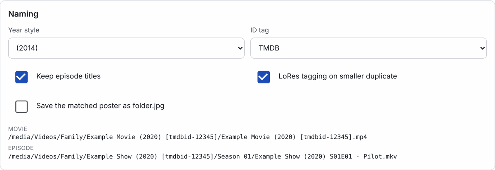

<p align="center">
  <picture>
    <source media="(prefers-color-scheme: dark)" srcset="docs/images/banner-dark.png">
    
  </picture>
</p>

<p align="center">
  Free · public domain · runs on your own PC · beta
</p>

<p align="center">
  
</p>

mediakeep looks at a folder of your video files (movies and TV shows), works out what each one is
(using [TMDB](https://www.themoviedb.org/)), and renames it the way Jellyfin likes it:

| Before | After |
| --- | --- |
| `Starfall.2014.1080p\Starfall.2014.1080p.mkv` | `Starfall (2014)\Starfall (2014).mkv` |
| `Starfall.2014.1080p\Starfall.2014.en.srt` | `Starfall (2014)\Starfall (2014).en.srt` |
| `the.lighthouse.keepers.s01e02.720p.mkv` | `The Lighthouse Keepers (2019)\Season 01\The Lighthouse Keepers (2019) S01E02 - The Fog Bell.mkv` |
| `Neon Harbor 2049 [1080p]\neon.harbor.2049.2017.mkv` | `Neon Harbor 2049 (2017)\Neon Harbor 2049 (2017).mkv` |

*(All titles, posters and screenshots in this README are made up for the demo.)*

You check everything in a web page on your own computer before anything changes on disk,
and every change can be undone.

## A quick look

<table>
  <tr>
    <td width="50%"><br><b>1. Choose a folder.</b> Rename everything where it is, or move it into another folder. Every row shows the full new path.</td>
    <td width="50%"><br><b>2. Scan.</b> Watch the files go by while mediakeep reads names and asks TMDB what each one is.</td>
  </tr>
  <tr>
    <td><br><b>3. Fix what it isn't sure about.</b> Pick from TMDB's suggestions with posters, search, or type the title yourself.</td>
    <td><br><b>4. Apply.</b> Everything you approved, in one list. Untick anything, then apply.</td>
  </tr>
  <tr>
    <td><br><b>5. Undo anytime.</b> Every run is recorded with an undo script you can read, download, or run with one click.</td>
    <td><br><b>Your naming, your way.</b> Year style, ID tags, episode titles and posters, with a live example.</td>
  </tr>
</table>

> **Status: beta.** It works well on real libraries, but test it on a copy of a folder first
> and keep backups of anything you can't replace.

---

## What it does (and doesn't)

- **Works on one folder at a time.** Pick a folder, check the list, apply. Then pick the next.
- **Renames in place by default.** Items stay in the folder you chose; only folder and file
  names change. Or choose a destination folder and they are moved into it.
- **Nothing changes until you press Apply** on the Execute page. Until then it's only a plan.
- **Only touches media.** Videos, their subtitles and their side files (`movie.mkv.nfo` and
  similar) move together. Samples, extras and anything it isn't sure about are left alone.
  It never deletes a video; it only removes folders that it emptied itself.
- **Everything can be undone**, from the History & undo page, or with the PowerShell undo
  script it writes for every run.
- **Asks when unsure.** Items it can't match with confidence are marked *Needs you*, with the
  best TMDB suggestions and posters to pick from.
- **Optional extras:** saves the matched poster as `folder.jpg`, adds `[tmdbid-…]` tags to
  folder names, and tags the smaller copy of a duplicate as `LoRes`.

It works only with video files you already have. It never searches for or downloads videos;
the only things it fetches are TMDB details and posters. It doesn't talk to Jellyfin either:
once the names are right, Jellyfin picks them up on its next library scan.

---

## What you need

- **Windows 10 or 11.** (The web app also runs on macOS and Linux, but it is built and tested
  on Windows, and the undo scripts are PowerShell.)
- **Python 3.11 or newer** from [python.org](https://www.python.org/downloads/). When the
  installer asks, tick **"Add python.exe to PATH"**.
- **A free TMDB API key.** Make an account at [themoviedb.org](https://www.themoviedb.org/),
  then go to *Settings → API* and request a key (choose "Personal" use). You'll paste it into
  mediakeep in a minute.
- **Optional: FFmpeg.** If `ffprobe` (part of FFmpeg) is installed, mediakeep reads video
  runtimes, which helps tell remakes and same-name titles apart. On Windows:
  `winget install Gyan.FFmpeg`.

---

## Install

1. Download mediakeep: on <https://github.com/SoMoney/mediakeep> click
   **Code → Download ZIP** and unzip it, for example to `C:\Tools\mediakeep`. Or, with Git:
   `git clone https://github.com/SoMoney/mediakeep.git C:\Tools\mediakeep`
2. Open **PowerShell** in that folder (in File Explorer: *File → Open Windows PowerShell*, or
   right-click the folder while holding Shift).
3. Create a private Python environment and install mediakeep into it:

   ```powershell
   python -m venv .venv
   .venv\Scripts\Activate.ps1
   pip install .
   ```

   If PowerShell says running scripts is disabled, run this once and try again:
   `Set-ExecutionPolicy -Scope CurrentUser RemoteSigned`

4. Check it works:

   ```powershell
   mediakeep doctor
   ```

---

## Start it

```powershell
cd C:\Tools\mediakeep
.venv\Scripts\Activate.ps1
mediakeep serve
```

Then open **<http://127.0.0.1:8765>** in your browser. Leave the PowerShell window open while you
use mediakeep; press **Ctrl+C** in it to stop.

Tip: you can skip the activate step with `C:\Tools\mediakeep\.venv\Scripts\mediakeep.exe serve`,
for example from a desktop shortcut.

---

## First use, step by step

1. **Add your TMDB key.** Go to **Settings → Services**, paste the key into *TMDB key*, click
   outside the box (it saves straight away), then click **Test the key**.
2. **Choose a folder.** On the **Folder** page click **Choose a folder…** and pick the folder
   that holds your movies or shows, for example `D:\Videos\Family`. mediakeep scans it; you'll
   see the files and folders go by.
3. **Choose where things go.**
   - **Rename here** (default): everything stays in the folder; only names change.
   - **Move to another folder**: pick a destination; items are renamed and moved into it.
4. **Check the list.** Each row shows the name on disk, what mediakeep thinks it is, and the
   full new path. Use the filters at the top:
   - **Ready** – matched with confidence; the new name is shown.
   - **Needs you** – not sure. Click **Use this match** if the suggestion is right, or
     **Check the match** to pick another TMDB result, search, or type the title yourself.
   - **Already tidy** – nothing to change.
   - **Left alone** – not a movie or show (or you told it to skip), so it won't be touched.
5. **Tick the rows you want** and click **Add … items to Execute**. Still nothing has changed.
6. **Apply.** Open **Execute**, untick anything you changed your mind about, and click
   **Apply**. Renames on the same drive take seconds.
7. **Undo if needed.** **History & undo** lists every run. Open one to see exactly what it did
   and the undo script, and click **Undo** to put everything back.

When a TMDB title differs from your folder name, the row lets you choose **Keep your title** or
**Use TMDB's** title.

### Remembered fixes

When you correct a match you can tick **Remember this choice**; mediakeep then handles that
name the same way in future scans (turn this on by default under *Settings → Matching*). The
**Remembered fixes** page lists them, lets you edit or forget them, and can import or export
them as a plain text file, one fix per line:

```text
# name on disk | name to use | options
The Lighthouse Keepers | The Lighthouse Keepers | kind=show
Starfall 2014          | Starfall               | tmdb=123456; kind=movie
Old Home Videos        |                        | ignore
The Paper Kite Trilogy |                        | split
```

Options: `kind=movie` or `kind=show`, `tmdb=<id>` (with `kind`), `ignore` (leave it alone),
`split` (a folder holding several films: give each its own folder).

---

## Settings

Most settings are on the **Settings** page and take effect immediately. They are stored in
`%APPDATA%\mediakeep\config.yaml`, which is created on first run (see
[`config.example.yaml`](config.example.yaml) for every option with comments).

| Setting | What it does |
| --- | --- |
| Year style | `Title (2014)` or `Title [2014]` |
| ID tag | Add `[tmdbid-…]` or `[imdbid-…]` to folder names (helps Jellyfin with remakes) |
| Keep episode titles | `Show (2019) S01E02 - Episode Title.mkv` instead of `Show (2019) S01E02.mkv` |
| LoRes tagging | With two copies of a film, name the smaller one `Title (2014) - LoRes.mkv` |
| Save the matched poster as folder.jpg | Download TMDB's poster into each item's folder |
| Remember match choices by default | Pre-tick *Remember this choice* when you pick a match |
| TMDB key | Your TMDB API key (*Test the key* checks it) |
| Web access token | Only needed if other computers will open the page (see below) |

### Using it from another computer

By default the web app only answers on this computer (`127.0.0.1`). To open it from another
device on your network, set `web.host: 0.0.0.0` and a long random `web.access_token` in
`config.yaml`; the page then asks for the token. mediakeep refuses to start on a network
address without one.

### Where mediakeep keeps its own files

`%LOCALAPPDATA%\mediakeep\` holds the database (scans, matches, history), the TMDB cache,
logs, and the undo scripts (`undo\undo-<run>.ps1`). To change it, set `state_dir` in
`config.yaml`.

---

## Command line

Everything is also available from PowerShell. The command line uses the same working folder
as the web app.

```powershell
mediakeep folder                               # show the working folder and destination
mediakeep folder D:\Videos\Family              # work in this folder, rename here
mediakeep folder D:\Videos\New --move-to D:\Videos\Movies   # ...or move items into another folder
mediakeep scan                                 # dry run: show what would change
mediakeep scan --only "D:\Videos\Family\Some Folder"       # just part of the folder
mediakeep scan --apply                         # do it
mediakeep scan --json                          # the plan as JSON
mediakeep runs                                 # list past runs
mediakeep undo RUN_ID                          # preview an undo
mediakeep undo RUN_ID --apply                  # undo a run
mediakeep hints import FILE | export FILE | list   # remembered fixes
mediakeep purge --apply                        # delete files mediakeep created (folder.jpg ...)
mediakeep config show                          # print settings (keys hidden)
mediakeep doctor                               # check TMDB key, ffprobe, long paths
mediakeep serve                                # start the web app
```

Exit codes: `0` done, `1` done but some items need you, `2` usage or settings problem,
`3` some changes failed.

---

## Tips and troubleshooting

- **"mediakeep was updated since this web app started."** You installed a new version; stop
  the web app (Ctrl+C) and start it again.
- **Long paths.** Deep folders can exceed Windows' old 260-character limit. `mediakeep doctor`
  shows whether long paths are enabled; if not, search for "Enable Win32 long paths".
- **Network drives** work. Moving between drives copies then deletes, so it is slower than
  renaming on one drive.
- **Updating:** download the new version over the old folder, then run `pip install .` again
  in the activated environment and restart the web app.
- **Something went wrong?** Look at the run on **History & undo**, and at the log files in
  `%LOCALAPPDATA%\mediakeep\logs`. Bug reports and ideas are welcome on the
  [issues page](https://github.com/SoMoney/mediakeep/issues).

---

## For developers

```powershell
pip install -e ".[dev]"
pytest
mypy mediakeep
mediakeep selftest
```

The code is a FastAPI web app (`mediakeep/web`) on top of a small pipeline:
scan → classify → identify (TMDB) → plan → apply, with every change written to a journal
so it can be undone. Contributions are welcome.

---

## Licence and credits

mediakeep is free and unencumbered software released into the **public domain**
(see [LICENSE](LICENSE), The Unlicense). Use it, change it, share it; no credit needed.

This product uses the TMDB API but is not endorsed or certified by TMDB. mediakeep is not
affiliated with Jellyfin.
